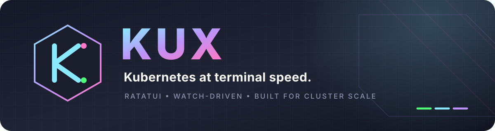
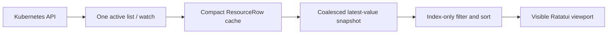

<p align="center">
  
</p>

<p align="center">
  <strong>K9s muscle memory. A watch-driven Rust data path. Every listable resource your API server serves.</strong>
</p>

<p align="center">
  Kux is a high-performance Kubernetes terminal UI built with
  <a href="https://github.com/ratatui/ratatui">Ratatui</a> for operators managing large,
  fast-moving clusters.
</p>

<p align="center">
  
  
  
  
</p>

---

## Why Kux

| Familiar in seconds | Complete by default | Responsive by design |
| --- | --- | --- |
| K9s-style commands, filters, hotkeys, namespace shortcuts, and in-place views. | Discovers built-ins, Secrets, CRDs, and aggregated APIs directly from Kubernetes. | Compact rows, atomic relists, coalesced watches, latest-value delivery, and viewport-only rendering. |

Kux keeps the workflow experienced Kubernetes operators already know, then rebuilds the data path
for large datasets. It loads one active resource view, never queues an unbounded stream of frames,
and does not require a hard-coded resource catalog.

## Try it in 10 seconds

Requires Rust 1.88 or newer.

```bash
cargo install --path .

# Explore 250,000 synthetic resources without touching a cluster.
kux --demo --demo-items 250000

# Open every namespace in the current kubeconfig context, read-only.
kux --read-only -A
```

Or run directly from the checkout:

```bash
cargo run --release -- --demo
cargo run --release -- --context my-cluster -A
cargo run --release -- -n production --resource pods
```

## The operator workflow, without leaving the keyboard

Command mode understands built-in aliases, server-provided CRD short names, and everything
discovered from the API server:

```text
:pod                       Pods in the current namespace
:deploy kube-system        Deployments in kube-system
:secret sn-system          Secrets without values in the list cache
:crd                       CustomResourceDefinitions
:workflows.argoproj.io     A group-qualified custom resource
:nodes.metrics.k8s.io      A list-only aggregated API
:ctx staging               Switch kubeconfig context
:ns all                    Watch every namespace
```

Filters update as you type:

```text
/api|worker                Case-insensitive regex
/!Running                  Inverse regex
/-f apisrvr                Fuzzy subsequence match
/-l app=api,env=prod       Label match
```

Navigation stays in place instead of stacking popups:

```text
Node ──Enter──▶ Pods on node ──Enter──▶ Containers ──Enter──▶ Logs
ServiceAccount ──Enter──▶ Effective RBAC policy matrix
Secret ──x──▶ Decoded data only
Resource ──y / d / e──▶ Formatted YAML / kubectl describe / interactive kubectl edit
```

Command and filter mode remain available from resource tables, contexts, details, YAML, describe,
logs, containers, and authorization policy views.

## Purpose-built Kubernetes views

| View | Operational data |
| --- | --- |
| Pods | `READY`, `STATUS`, restarts, CPU and memory usage versus requests/limits, node, age |
| Nodes | status, taint count, version, pod count, CPU/memory usage and allocatable capacity |
| APIService | backing service, Available condition, and age for local and aggregated APIs |
| ServiceAccount and RBAC | resource/API group, binding source, and the full verb matrix |
| Secrets | encoded YAML toggle or decoded `data`-only view; values never enter the list cache |
| Any discovered resource | sortable metadata view, formatted YAML, real describe output, and filters |

Kux uses the exact group, version, plural, scope, and operations advertised by discovery. If the
API server serves a listable resource, Kux can open it—even when it is a CRD or comes from an
aggregated API server.

## Built for cluster scale



- **Atomic relists.** A new list is assembled off-screen and swapped in only when complete.
- **Bounded delivery.** `tokio::watch` retains the newest snapshot instead of building a backlog.
- **Compact state.** Kubernetes objects become small reference-counted display rows immediately.
- **Generation safety.** Results from cancelled views cannot overwrite the active dataset.
- **Viewport rendering.** Widgets are created only for rows visible in the terminal.
- **Independent enrichment.** Metrics, node pod counts, YAML, logs, and actions do not block input.
- **Graceful API coverage.** Watchable resources stream; list-only APIs use bounded pagination.

Want to exercise filtering, sorting, selection, and rendering without API-server latency?

```bash
kux --demo --demo-items 100000
```

See the [architecture notes](docs/architecture.md) for the complete pipeline and tradeoffs.

## Essential keys

The header always shows the actions available in the current view. These are the essentials:

| Key | Action |
| --- | --- |
| `:`, `/` | Command mode and filter mode |
| `0`, `1`…`9` | All namespaces, then the nine most recent named namespaces |
| `h`/`j`/`k`/`l`, arrows, `Ctrl-B`/`Ctrl-F`, `PgUp`/`PgDn`, `g`/`G` | Navigate, go back, or open contextually |
| `Enter` | Drill into the selected resource |
| `y`, `d` | YAML and `kubectl describe` |
| `e` | Edit the selected resource with `kubectl edit` |
| `l`, `p` | Current and previous logs |
| `c`, `n` | Copy resource name or namespace |
| `x` on Secret | Open decoded data only; in YAML, toggle decoded values |
| `Space`, `Ctrl-Space`, `Ctrl-\` | Mark one, mark a range, clear marks |
| Left-click a column | Sort; click again to reverse |
| `Ctrl-R` | Restart the active watch |
| `Ctrl-D` | Delete the selected resource or inactive kubeconfig context with confirmation |
| `Ctrl-L`, `Ctrl-E`, `Ctrl-W` | Toggle logo, header, and wide columns |
| `:q`, `Ctrl-C` | Quit |

Press `?` for the categorized keymap in the body. The full compatibility surface is documented in the
[K9s interaction matrix](docs/k9s-parity.md).

## Safety and requirements

- The header shows Context, its referenced Cluster and User, and the server Version. `:ctx` shows
  Name/Cluster/User/Namespace; `:ns` shows Name/Status/Age, and `y` opens the selected Namespace
  YAML.
- Kux uses the active kubeconfig context and default namespace unless overridden.
- Start with `--read-only` to disable resource and context deletion, kill, edit, restart, and future
  mutation paths.
- `Ctrl-D` uses a guarded confirmation and refuses the active context; `Ctrl-K` intentionally
  requests zero-grace resource deletion.
- `kubectl` is required for describe views, interactive resource editing, and kubeconfig context
  deletion.
- The Metrics API is optional; Pod and Node usage columns remain unavailable when it is absent.
- Use `--legacy-list` for API servers that do not support streaming initial lists.
- Use `--no-logo` for compact terminals; `Ctrl-L` toggles the logo at runtime.

## Project status

The high-scale list/watch pipeline, dynamic discovery, metrics, YAML, describe, logs, Secret
decoding, context/namespace switching, mouse sorting, and RBAC policy views are functional.
Exec/attach, port forwarding, editors, ownership traversal, and specialized workload/node
mutations remain planned.

Kux follows the interaction model popularized by
[K9s](https://github.com/derailed/k9s) but does not import K9s code and is not affiliated with the
K9s project.

## Documentation

- [Architecture and scale model](docs/architecture.md)
- [K9s interaction parity](docs/k9s-parity.md)

## License

Kux is available under the [Apache License 2.0](LICENSE).
