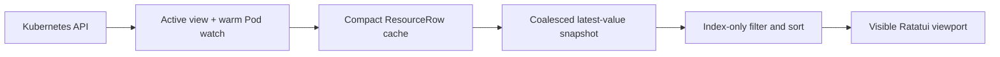

<p align="center">
  
</p>

<p align="center">
  <strong>K9s muscle memory. A watch-driven Rust data path. Every listable resource your API server serves.</strong>
</p>

<p align="center">
  Kux is a high-performance Kubernetes terminal UI built with
  <a href="https://github.com/ratatui/ratatui">Ratatui</a> for operators managing large,
  fast-moving clusters.
</p>

<p align="center">
  
  
  
  
</p>

---

## Why Kux

| Familiar in seconds | Complete by default | Responsive by design |
| --- | --- | --- |
| K9s-style commands, filters, hotkeys, namespace shortcuts, and in-place views. | Discovers built-ins, Secrets, CRDs, and aggregated APIs directly from Kubernetes. | Compact rows, atomic relists, coalesced watches, latest-value delivery, and viewport-only rendering. |

Kux keeps the workflow experienced Kubernetes operators already know, then rebuilds the data path
for large datasets. It loads one active resource view plus a compact live all-namespace Pod cache,
never queues an unbounded stream of frames, and does not require a hard-coded resource catalog.

## Install and run

Install with [Homebrew](https://brew.sh) on macOS or Linux:

```bash
brew install maxsxu/tap/kux
```

The formula is maintained in [maxsxu/homebrew-tap](https://github.com/maxsxu/homebrew-tap).
It builds Kux from source and installs Rust and `kubectl` as dependencies; the first
build can take several minutes. While this repository is private, Git must be
authenticated with an account that has access (for example, run `gh auth login`
and `gh auth setup-git` first).

Or build from a local checkout with Rust 1.88 or newer:

```bash
cargo install --locked --path .
```

Then try Kux:

```bash
# Explore 250,000 synthetic resources without touching a cluster.
kux --demo --demo-items 250000

# Open every namespace in the current kubeconfig context, read-only.
kux --read-only -A
```

Or run directly from the checkout:

```bash
cargo run --release -- --demo
cargo run --release -- --context my-cluster -A
cargo run --release -- -n production --resource pods
```

## The operator workflow, without leaving the keyboard

Command mode understands built-in aliases, server-provided CRD short names, and everything
discovered from the API server:

```text
:pod                       Pods in the current namespace
:deploy kube-system        Deployments in kube-system
:secret sn-system          Secrets without values in the list cache
:crd                       CustomResourceDefinitions
:workflows.argoproj.io     A group-qualified custom resource
:nodes.metrics.k8s.io      A list-only aggregated API
:ctx staging               Switch kubeconfig context
:ns all                    Watch every namespace
```

Filters update as you type:

```text
/api|worker                Case-insensitive regex
/!Running                  Inverse regex
/-f apisrvr                Fuzzy subsequence match
/-l app=api,env=prod       Label match
```

Matches are highlighted in tables and content. After applying a filter, `n` selects or scrolls to
the next match and `Shift-N` moves to the previous match, wrapping at either end.

Navigation stays in place instead of stacking popups:

```text
Node ──Enter──▶ Pods on node ──Enter──▶ Containers ──Enter──▶ Logs
Pod ──s──▶ Interactive shell with the resolved spec container in its identity banner
Pod ──o──▶ Assigned Node
Deployment ──Enter──▶ ReplicaSets ──Enter──▶ Pods
StatefulSet / DaemonSet / selector-backed Service ──Enter──▶ Pods
CRD ──Enter──▶ Custom resources served by that CRD
Any other owner ──Enter──▶ Resources whose owner reference matches its UID
ServiceAccount ──Enter──▶ Effective RBAC policy matrix
Secret ──x──▶ Decoded data only
Resource ──y / d / e──▶ Formatted YAML / kubectl describe / interactive kubectl edit
```

Command and filter mode remain available from resource tables, contexts, details, YAML, describe,
logs, containers, and authorization policy views. In YAML, `/` keeps the complete document visible
and scrolls directly to the first matching line; `n` and `Shift-N` continue through the document.

## Purpose-built Kubernetes views

| View | Operational data |
| --- | --- |
| Pods | `READY`, `STATUS`, restarts, CPU and memory usage versus requests/limits, node, age |
| Nodes | status, taint count, version, pod count, CPU/memory usage and allocatable capacity |
| APIService | kubectl-compatible `NAME`, `SERVICE`, `AVAILABLE`, and `AGE`, including `Local` services and compound multi-year ages |
| ServiceAccount and RBAC | resource/API group, binding source, and the full verb matrix |
| Secrets | encoded YAML toggle or decoded `data`-only view; values never enter the list cache |
| Any discovered resource | sortable metadata view, formatted YAML, real describe output, and filters |

Kux uses the exact group, version, plural, scope, and operations advertised by discovery. If the
API server serves a listable resource, Kux can open it—even when it is a CRD or comes from an
aggregated API server.

## Built for cluster scale



- **Atomic relists.** A new list is assembled off-screen and swapped in only when complete.
- **Bounded delivery.** `tokio::watch` retains the newest snapshot instead of building a backlog.
- **Compact state.** Kubernetes objects become small reference-counted display rows immediately.
- **Compact first paint.** Kubernetes clients authenticate before entering a resource view. The
  all-namespace Pod view exposes 250 gzip-compressed Table rows without embedded objects, follows
  with a paged typed snapshot, and progressively overlays complete Pods without shrinking the list.
  Other built-in views start from metadata Table rows before typed enrichment completes.
- **Warm Pod navigation.** A live, in-memory all-namespace Pod watch starts with Kux and remains
  current while other resources are viewed, so opening `pods(all)` reuses an existing snapshot.
- **Progressive large lists.** Table-backed views expose another snapshot after each bounded
  5,000-row page, while later relists remain atomic.
- **Compact CRD tables.** Dynamic lists request metadata-only Table rows in bounded 5,000-row pages
  instead of downloading full CRD objects up front.
- **Generation safety.** List snapshots and read-action results from cancelled views cannot
  overwrite the active dataset; obsolete YAML/log requests are aborted when navigation changes.
- **Viewport rendering.** Table rows and unwrapped YAML/log/describe lines are styled and allocated
  only for the visible terminal viewport.
- **Lazy managed fields.** Initial YAML formatting omits Kubernetes `managedFields`; press `m` to
  load them on demand, after which toggling remains local and instant.
- **Independent enrichment.** Metrics, node pod counts, YAML, logs, and actions do not block input.
- **Graceful API coverage.** Watchable resources stream; list-only APIs use bounded pagination.

Want to exercise filtering, sorting, selection, and rendering without API-server latency?

```bash
kux --demo --demo-items 100000
```

See the [architecture notes](docs/architecture.md) for the complete pipeline and tradeoffs.

## Essential keys

The header always shows the actions available in the current view. These are the essentials:

| Key | Action |
| --- | --- |
| `:`, `/` | Command mode and filter mode |
| `0`, `1`…`9` | All namespaces, then the nine most recent named namespaces; log views use `0`…`6` for time ranges |
| `j`/`k`, Up/Down, `Ctrl-B`/`Ctrl-F`, `PgUp`/`PgDn`, `g`/`G` | Navigate vertically |
| `h`/`l` | Go back or open contextually |
| Left/Right | Scroll text views and Pod tables horizontally; never open, close, or activate an item |
| `Enter` | Drill into the selected resource |
| `Shift-J` | Jump to the selected resource's controller owner |
| `y`, `d` | YAML and `kubectl describe` |
| `e` | Edit the selected resource from its list, details, or YAML view with `kubectl edit` |
| `l`, `p` | Colorized current and previous logs for the resolved Pod/container |
| `o` on Pods | Jump to the Pod's assigned Node |
| `c`, `n` | Copy resource name or namespace; `c` copies the active content in YAML, Secret-data, and log views |
| `x` on Secret | Open decoded data only; in YAML, toggle decoded values |
| `Space`, `Ctrl-Space`, `Ctrl-\` | Mark one, mark a range, clear marks |
| Left-click a row | Select that resource without changing marked resources |
| Left-click a column | Sort; click again to reverse |
| `Ctrl-R` | Restart the active watch |
| `Ctrl-D` | Delete all marked resources, the current resource when none are marked, or an inactive context—with confirmation |
| `r` on Deployments, StatefulSets, or DaemonSets | Confirm and request a rollout restart for all marked workloads, or the current workload |
| `u` on Nodes | Confirm and cordon or uncordon the selected node |
| `r` on Nodes | Configure, confirm, cordon, and drain the selected node |
| `Shift-F` on Pods or Services | Start a port forward |
| `f` on Pods or Services, `:pf` globally | Open the context-wide port-forward list; `Ctrl-D` stops one |
| `Ctrl-L`, `Ctrl-E`, `Ctrl-W` | Toggle logo, header, and wide columns |
| `:q`, `Ctrl-C` | Quit |

Press `?` for the categorized keymap in the body. The full compatibility surface is documented in the
[K9s interaction matrix](docs/k9s-parity.md).

### Pod logs

Current logs stream continuously, starting with the last 100 lines. The log header shows the
K9s controls, highlights active toggles, and replaces namespace shortcuts with log ranges:

| Key | Action |
| --- | --- |
| `0`, `1` | Tail, or head (the first 5,000 bytes without following) |
| `2`, `3`, `4`, `5`, `6` | Last 1m, 5m, 15m, 30m, or 1h; start with up to 100 matching recent lines and follow |
| `Shift-C` | Clear the local log buffer; incoming messages continue |
| `c`, `Ctrl-S` | Copy or save the complete displayed buffer, respecting filter and timestamp settings |
| `m` | Insert a colored separator mark |
| `s` | Pause or resume autoscroll; incoming logs stay buffered while the display is paused |
| `Shift-L` | Keep the horizontal scroll position when messages arrive |
| `f`, `t`, `w` | Toggle borderless fullscreen, API timestamps, or line wrapping |

The title shows the selected range and whether logs are following, paused, or complete. Previous
container logs use the same controls but finish after the previous instance's log has been read.
Buffers retain at most 5,000 lines or 4 MiB. Copy and save include the whole displayed buffer, not
just the visible screen, and omit terminal control sequences. `Ctrl-S` creates a new private
(`0600`) file under `$XDG_STATE_HOME/kux/screen-dumps/<context>/`, defaulting to
`~/.local/state/kux/screen-dumps/<context>/`, and shows the saved path. Nothing is saved automatically.

## Safety and requirements

- The header shows Context, its referenced Cluster and User, and the server Version. `:ctx` shows
  Name/Cluster/User/Namespace and supports `c` to copy the selected context name; `:ns` shows
  Name/Status/Age, and `y` opens the selected Namespace YAML.
- Kux uses the active kubeconfig context and default namespace unless overridden.
- Start with `--read-only` to disable resource and context deletion, kill, edit, restart, Pod shell,
  port forwarding, and future mutation paths.
- `Ctrl-D` uses a guarded confirmation, batches all marked resources, and refuses the active
  context; `Ctrl-K` intentionally requests zero-grace deletion of the current resource.
- Workload restart uses a guarded confirmation and patches the Pod template's
  `kubectl.kubernetes.io/restartedAt` annotation, triggering the controller's normal rollout.
- Node status combines readiness and scheduling state, for example `Ready` or
  `NotReady,Unschedulable`.
- Node drain exposes grace period (`-1` keeps the Kubernetes default), timeout, Ignore DaemonSets,
  Delete EmptyDir Data, Force, and Disable Eviction options. Static mirror pods are always skipped;
  the default checks block DaemonSet, EmptyDir, and unmanaged pods before cordoning. Evictions honor
  PodDisruptionBudgets unless Disable Eviction is selected.
- `kubectl` is required for describe views, interactive resource editing, Pod shell, port
  forwarding, and kubeconfig context deletion.
- The Metrics API is optional; Pod and Node usage columns remain unavailable when it is absent.
- Use `--legacy-list` for API servers that do not support streaming initial lists.
- Use `--no-logo` for compact terminals; `Ctrl-L` toggles the logo at runtime.

## Project status

The high-scale list/watch pipeline, dynamic discovery, metrics, YAML, describe, logs, Secret
decoding, context/namespace switching, mouse sorting, owner traversal, Pod shell, port forwarding,
interactive editing, and RBAC policy views are functional. Attach and workload scaling remain
planned.

Kux follows the interaction model popularized by
[K9s](https://github.com/derailed/k9s) but does not import K9s code and is not affiliated with the
K9s project.

## Documentation

- [Architecture and scale model](docs/architecture.md)
- [K9s interaction parity](docs/k9s-parity.md)

## License

Kux is available under the [Apache License 2.0](LICENSE).
