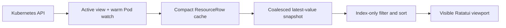

<p align="center">
  
</p>

<p align="center">
  <strong>K9s muscle memory. A watch-driven Rust data path. Every listable resource your API server serves.</strong>
</p>

<p align="center">
  Kux is a high-performance Kubernetes terminal UI built with
  <a href="https://github.com/ratatui/ratatui">Ratatui</a> for operators managing large,
  fast-moving clusters.
</p>

<p align="center">
  
  
  
  
</p>

---

## Why Kux

| Familiar in seconds | Complete by default | Responsive by design |
| --- | --- | --- |
| K9s-style commands, filters, hotkeys, namespace shortcuts, and in-place views. | Discovers built-ins, Secrets, CRDs, and aggregated APIs directly from Kubernetes. | Compact rows, atomic relists, coalesced watches, latest-value delivery, and viewport-only rendering. |

Kux keeps the workflow experienced Kubernetes operators already know, then rebuilds the data path
for large datasets. It loads one active resource view plus a compact live all-namespace Pod cache,
never queues an unbounded stream of frames, and does not require a hard-coded resource catalog.

## Install and run

Install with [Homebrew](https://brew.sh) on macOS or Linux:

```bash
brew install maxsxu/tap/kux
```

The formula is maintained in [maxsxu/homebrew-tap](https://github.com/maxsxu/homebrew-tap).
It builds Kux from source and installs Rust and `kubectl` as dependencies; the first
build can take several minutes. While this repository is private, Git must be
authenticated with an account that has access (for example, run `gh auth login`
and `gh auth setup-git` first).

Or build from a local checkout with Rust 1.88 or newer:

```bash
cargo install --locked --path .
```

Then try Kux:

```bash
# Explore 250,000 synthetic resources without touching a cluster.
kux --demo --demo-items 250000

# Open every namespace in the current kubeconfig context, read-only.
kux --read-only -A
```

Or run directly from the checkout:

```bash
cargo run --release -- --demo
cargo run --release -- --context my-cluster -A
cargo run --release -- -n production --resource pods
```

### Connection options

Select a kubeconfig file and apply connection overrides consistently to resource watches, actions,
and built-in `kubectl` operations:

```bash
kux --kubeconfig ~/.kube/staging --context staging \
  --as auditor --as-group readers --request-timeout 30s
```

Supported overrides are `--cluster`, `--user`, `--server`, `--as`, repeated `--as-group`,
`--certificate-authority`, `--client-certificate`, `--client-key`, `--token`, and
`--insecure-skip-tls-verify[=true|false]`. Explicit kubeconfig/context/cluster/user selections do
not fall back to a different credential source when invalid. Overrides remain active after a
context switch. `--request-timeout` accepts values such as `500ms` or `1m30s`; `0` disables its
timeouts. In the Rust client it sets separate connect/read/write timeouts, rather than one deadline
for the complete operation; built-in `kubectl` receives the same flag value.

### Display, refresh, and offline commands

```bash
kux --headless --logoless --crumbsless --splashless
kux --invert --refresh 2.75 --screen-dump-dir /tmp/kux-dumps
kux info
kux version --short
kux completion zsh > _kux
```

`--headless` hides the header; `--logoless` aliases `--no-logo`. Breadcrumbs and a brief startup
splash can be hidden independently. `--invert` changes perceived color lightness while preserving
hue. `--refresh` controls Metrics API and list-only API cadence; it defaults to five seconds and
values below two seconds are clamped to two. Streaming watches and their publication rate remain
independent. YAML and Describe use a separate five-second interval when auto-refresh is enabled.
Kux retains `-r` for `--resource`.

`info`, `version`, and `completion` run without connecting to Kubernetes or entering the TUI.
`info` reports configuration/data paths and the default or CLI-selected dump and log paths;
`version --short` prints version/build fields without the heading. Diagnostic logging flags
`-l`/`--logLevel` and `--logFile` (plus `K9S_LOGS_DIR`/`KUX_LOGS_DIR`) are supported. Completion
scripts contain static commands and options; dynamic kubeconfig context, cluster, user, and
namespace completion is not implemented.

## The operator workflow, without leaving the keyboard

Command mode understands built-in aliases, server-provided CRD short names, and everything
discovered from the API server:

```text
:pod                       Pods in the current namespace
:deploy kube-system        Deployments in kube-system
:secret sn-system          Secrets without values in the list cache
:crd                       CustomResourceDefinitions
:workloads / :wk           Aggregate Pods, Services, DaemonSets, StatefulSets, Deployments and ReplicaSets
:users / :groups           Enumerate RBAC Users and Groups from RoleBindings and ClusterRoleBindings
:can u:alice / :can g:dev  Inspect effective RBAC policy for a User, Group, or ServiceAccount (:can s:ns/sa)
:workflows.argoproj.io     A group-qualified custom resource
:nodes.metrics.k8s.io      A list-only aggregated API
:ctx staging               Switch kubeconfig context
:ns all                    Watch every namespace
```

Filters update as you type:

```text
/api|worker                Case-insensitive regex
/!Running                  Inverse regex
/-f apisrvr                Fuzzy subsequence match
/-l app=api,env=prod       Label match
```

Matches are highlighted in tables and content. After applying a filter, `n` selects or scrolls to
the next match and `Shift-N` moves to the previous match, wrapping at either end.

Navigation stays in place instead of stacking popups:

```text
Node ──Enter──▶ Pods on node ──Enter──▶ Containers ──Enter──▶ Logs
Pod ──s──▶ Interactive shell with the resolved spec container in its identity banner
Pod ──o──▶ Assigned Node
Deployment ──Enter──▶ Pods
Deployment ──z──▶ ReplicaSets ──Enter──▶ Pods
ReplicaSet ──Ctrl-L──▶ Review and restore its Deployment revision
StatefulSet / DaemonSet / selector-backed Service ──Enter──▶ Pods
CronJob ──Enter──▶ Jobs owned by name ──Enter──▶ Pods selected by the Job
CRD ──Enter──▶ Custom resources served by that CRD
Any other owner ──Enter──▶ Resources whose owner reference matches its UID
ServiceAccount / User / Group ──Enter──▶ Effective RBAC policy matrix
Namespace ──u / Enter──▶ Set active namespace / open Pods in namespace
Secret ──x──▶ Decoded data only
ConfigMap / Secret / PVC / ServiceAccount / PriorityClass ──u──▶ UsedBy references
UsedBy ──Enter──▶ Selected workload instance ──Esc──▶ UsedBy
Workloads ──Enter──▶ Selected resource instance ──Esc──▶ Workloads
Resource ──y / d / e──▶ Formatted YAML / kubectl describe / interactive kubectl edit
```

Command and filter mode remain available from resource tables, contexts, details, YAML, describe,
logs, containers, reference lists, and authorization policy views. In YAML, `/` keeps the complete document visible
and scrolls directly to the first matching line; `n` and `Shift-N` continue through the document.
YAML and Describe load once by default. Press `r` to enable or disable auto-refresh; enabling it
in a loaded view refreshes immediately, then every five seconds. During the initial Loading view,
`r` changes the subsequent refresh setting while allowing that first read to finish. Escape
cancels loading, and late results cannot reopen a closed view or replace a newer one.
Set `liveViewAutoRefresh: true` to start newly
opened views with auto-refresh enabled. Refreshes preserve scrolling, search, wrap, fullscreen,
and YAML managed-fields/decoded Secret settings. Failures retain the last content and retry with
backoff for a bounded two-minute window; toggle `r` off and on to restart after exhaustion.
Returning from `kubectl edit` keeps the open view and refreshes it once, including when automatic
refresh is disabled. Initial reads have a ten-second timeout; a failed read replaces Loading with
an error notice, and a successful retry clears that failure. Defaults are sampled when opening
the view, so configuration reload or a delayed response does not reset changes made while loading.

Press Enter on a CronJob to open its Jobs in the selected namespace, or on a Job to open
Pods matching its selector. These reads run asynchronously and remain available in read-only
mode. Escape restores the previous resource view.

Press `u` on a ConfigMap, Secret, PVC, ServiceAccount, or PriorityClass to scan Deployment,
StatefulSet, DaemonSet, Job, and CronJob Pod templates. Namespaced resources scan their own
namespace; PriorityClasses scan every namespace. The reference list supports filters, mouse
sorting, `Shift-V` GVR sorting, and `Ctrl-R` refresh. Enter opens the selected workload's resource
instance through an exact read; Escape returns to the reference list with its filter,
sort, and selection. A source faults-only filter does not hide references or the destination
workload, and is restored on return. Scans refresh at the configured interval, retain available
results when some API reads fail, and show a partial-results warning. UsedBy is available in
read-only mode.

Use `:workloads` or `:wk` to combine Pods, Services, DaemonSets, StatefulSets, Deployments and
ReplicaSets in one table. The `KIND` column shows each row's full GVR, so same-named resources stay
distinct. `Shift-K`, `Shift-R` and `Shift-A` sort kind, readiness and age; readiness uses natural
order and age starts youngest first. `Ctrl-W` reveals the `VALID` column. Filters, fault filtering,
marking, CSV export and namespace selection work across
the combined table. YAML, Describe, Edit and confirmed deletion use each row's actual resource
kind; applicable typed actions such as logs and scaling are available after Enter opens the selected instance.
Escape restores the aggregate view's filter, sorting, selection and marks. Workloads Goto retains
the active namespace; UsedBy Goto switches to the reference's namespace. Instance views fetch one
named object and refresh at the configured interval.

## Purpose-built Kubernetes views

| View | Operational data |
| --- | --- |
| Pods | `READY`, `STATUS`, restarts, CPU and memory usage versus requests/limits, node, age |
| Nodes | status, taint count, version, pod count, CPU/memory usage and allocatable capacity |
| APIService | kubectl-compatible `NAME`, `SERVICE`, `AVAILABLE`, and `AGE`, including `Local` services and compound multi-year ages |
| ServiceAccount and RBAC | resource/API group, binding source, and the full verb matrix |
| UsedBy references | `NAMESPACE`, `NAME`, `GVR` for workloads using a ConfigMap, Secret, PVC, ServiceAccount, or PriorityClass |
| Aggregate workloads | `KIND`, `NAMESPACE`, `NAME`, `STATUS`, `READY`, `AGE`; wide-only `VALID`, per-row resource actions, and exact instance navigation |
| Secrets | encoded YAML toggle or decoded `data`-only view; values never enter the list cache |
| Any discovered resource | sortable metadata view, formatted YAML, real describe output, and filters |

Kux uses the exact group, version, plural, scope, and operations advertised by discovery. If the
API server serves a listable resource, Kux can open it—even when it is a CRD or comes from an
aggregated API server.

## Built for cluster scale



- **Atomic relists.** A new list is assembled off-screen and swapped in only when complete.
- **Bounded delivery.** `tokio::watch` retains the newest snapshot instead of building a backlog.
- **Compact state.** Kubernetes objects become small reference-counted display rows immediately.
- **Compact first paint.** Kubernetes clients authenticate before entering a resource view. The
  all-namespace Pod view exposes 250 gzip-compressed Table rows without embedded objects, follows
  with a paged typed snapshot, and progressively overlays complete Pods without shrinking the list.
  Other built-in views start from metadata Table rows before typed enrichment completes.
- **Warm Pod navigation.** A live, in-memory all-namespace Pod watch starts with Kux and remains
  current while other resources are viewed, so opening `pods(all)` reuses an existing snapshot.
- **Progressive large lists.** Table-backed views expose another snapshot after each bounded
  5,000-row page, while later relists remain atomic.
- **Compact CRD tables.** Dynamic lists request metadata-only Table rows in bounded 5,000-row pages
  instead of downloading full CRD objects up front.
- **Generation safety.** List snapshots and read-action results from cancelled views cannot
  overwrite the active dataset; obsolete YAML/log requests are aborted when navigation changes.
- **Viewport rendering.** Table rows and unwrapped YAML/log/describe lines are styled and allocated
  only for the visible terminal viewport.
- **Lazy managed fields.** Initial YAML formatting omits Kubernetes `managedFields`; press `m` to
  load them on demand, after which toggling remains local and instant.
- **Independent enrichment.** Metrics, node pod counts, YAML, logs, and actions do not block input.
- **Graceful API coverage.** Watchable resources stream; list-only APIs use bounded pagination.

Want to exercise filtering, sorting, selection, and rendering without API-server latency?

```bash
kux --demo --demo-items 100000
```

See the [architecture notes](docs/architecture.md) for the complete pipeline and tradeoffs.

## Essential keys

The header always shows the actions available in the current view. These are the essentials:

| Key | Action |
| --- | --- |
| `:`, `/` | Command mode and filter mode |
| `0`, `1`…`9` | All namespaces, then the nine most recent named namespaces; log views use `0`…`6` for time ranges |
| `j`/`k`, Up/Down, `Ctrl-B`/`Ctrl-F`, `PgUp`/`PgDn`, `g`/`G` | Navigate vertically |
| `h`/`l` | Go back or open contextually |
| Left/Right | Scroll text views and Pod tables horizontally; never open, close, or activate an item |
| `Enter` | Drill into the selected resource |
| `Shift-J` | Jump to the selected resource's controller owner |
| `y`, `d` | YAML and `kubectl describe` |
| `e` | Edit the selected resource from its list, details, YAML, or Describe view with `kubectl edit` |
| `r` in YAML or Describe | Toggle automatic refresh |
| `i` on Pods, Deployments, StatefulSets, or DaemonSets | Edit regular and init container images |
| `t` on Pods | Upload or download files through `kubectl cp` |
| `z` on Pods | Confirm sanitization of eligible Pods in the current namespace scope |
| `z` on Deployments | Open label-selected ReplicaSets |
| `Ctrl-L` on ReplicaSets | Review and confirm rollback of the owning Deployment |
| `l`, `p` | Current and previous logs for Pods, containers, Deployments, StatefulSets, DaemonSets, Services, and Jobs |
| `o` on Pods | Jump to the Pod's assigned Node |
| `c`, `n` | Copy resource name or namespace; `c` copies the active content in YAML, Secret-data, and log views |
| `Ctrl-S` | Export the full filtered/sorted resource table as CSV, or save the current content view |
| `:screendump`, `:sd` | Browse, preview, edit, and delete saved exports for the current cluster/context |
| `x` on Secret | Open decoded data only; in YAML, toggle decoded values |
| `Space`, `Ctrl-Space`, `Ctrl-\` | Mark one, mark a range, clear marks |
| Left-click a row | Select that resource without changing marked resources |
| Left-click a column | Sort; click again to reverse |
| `Ctrl-R` | Restart the active watch |
| `Ctrl-D` | Delete all marked resources, the current resource when none are marked, or an inactive context—with confirmation |
| `a` on Pods or containers | Attach to the default or selected container process |
| `s` on scalable resources | Set desired replicas for marked resources or the current resource; supports discovered CRD scale subresources |
| `t`, `s` on CronJobs | Confirm triggering Jobs for marked/current CronJobs, or toggle the current CronJob's suspension |
| `:suspend`, `:resume` on Jobs or CronJobs | Explicitly set suspension for marked/current resources |
| `r` on Deployments, StatefulSets, or DaemonSets | Confirm and request a rollout restart for all marked workloads, or the current workload |
| `u` on Nodes | Confirm and cordon or uncordon the selected node |
| `r` on Nodes | Configure, confirm, cordon, and drain the selected node |
| `Shift-F` on Pods or Services | Start a port forward |
| `f` on Pods or Services, `:pf` globally | Open the context-wide port-forward list; `Ctrl-D` stops one |
| `Ctrl-L` outside ReplicaSets, `Ctrl-E`, `Ctrl-W` | Toggle logo, header, and wide columns |
| `:q`, `Ctrl-C` | Quit |

Press `?` for the categorized keymap in the body. The full compatibility surface is documented in the
[K9s interaction matrix](docs/k9s-parity.md).

### Pod and workload logs

Press `l` or `p` on a Pod, Deployment, StatefulSet, DaemonSet, Service, or Job for current or
previous logs. Workload and Service selectors resolve Pods in the selected resource's namespace.
A valid default-container annotation on the selected Pod or workload chooses its initial
container. A single-container Pod or workload template also keeps that container selected;
otherwise all regular, init, and ephemeral containers are included. Services always open all
containers. Enter on a container keeps that explicit container selected. When an annotated
default is available, `a` switches between it and all containers; on a single-container scope it
has no effect. Logs remain available in read-only mode.

Streams start with the configured tail (100 lines per source by default). The header shows K9s
controls, highlights active toggles, and replaces namespace shortcuts with log ranges:

| Key | Action |
| --- | --- |
| `0`, `1` | Tail, or head (the first 5,000 bytes per source without following) |
| `2`, `3`, `4`, `5`, `6` | Last 1m, 5m, 15m, 30m, or 1h; start with up to the configured tail count and follow |
| `a` | Toggle the annotated default versus all containers; unavailable for an explicit container selection |
| `Shift-C` | Clear the local log buffer; incoming messages continue |
| `c`, `Ctrl-S` | Copy or save the complete displayed buffer, respecting filter and timestamp settings |
| `m` | Insert a colored separator mark |
| `s` | Pause or resume autoscroll; incoming logs stay buffered while the display is paused |
| `Shift-L` | Keep the horizontal scroll position when messages arrive |
| `f`, `t`, `w` | Toggle borderless fullscreen, API timestamps, or line wrapping |

The title shows the selected range and whether logs are following, paused, or complete. Current
and previous logs both follow outside head mode and finish on clean EOF. Merged lines show the
API timestamp first when enabled, then the Pod for workload logs and the container when needed.
Pod or container identity determines a stable prefix color. Filters, copy and exports include
these identity prefixes. Buffers retain the configured line count, capped at 5,000 lines and
4 MiB. Copy and save include the whole displayed buffer, not just the visible screen, and omit
terminal control sequences.
Logger settings below apply when a log view opens; changing ranges preserves its current toggles,
while reopening applies the latest configured defaults.

Log request and stream errors retry with backoff for at most 20 attempts. Clean EOF completes the
view; completed, terminating, or deleted Pods stop retries. Reconnection preserves the selected
Pod/container and range, using timestamps to suppress replayed lines. If the bounded replay
window cannot safely identify lines, Kux keeps the displayed output and asks you to reopen logs.
Every resolved source is followed concurrently; a failed source is reported while the others
continue. A log session resolves its Pod membership once. Reopening logs, changing range, or
toggling all containers resolves it again; existing sessions do not automatically discover new
Pods during a rollout. Targets identify Pods by namespace/name, so same-name replacements are
not distinguished by UID.

### Container images

Press `i` on a Pod, Deployment, StatefulSet, or DaemonSet to load an image form. Init and regular
containers have separate fields. Tab moves between fields and buttons; choose Save and press
Enter to apply, or use Cancel/Escape to discard changes. Blank or unchanged fields keep their
original images. Only changed images are submitted, with the loaded object's UID and version;
if the object changed or was replaced, reopen the form before retrying. Image updates are disabled
in read-only mode. Pods with an owner reference are rejected; edit the owning workload's template
instead. Pod ownership and identity are checked again before saving.

### Deployment revisions

Enter on a Deployment opens Pods matching its selector; `z` opens its ReplicaSets. Enter on a
ReplicaSet opens that revision's Pods. Both routes use the selected row's namespace and preserve
server selectors in back/forward history. Parent text filters clear when the resource kind changes.
Escape cancels a pending child-view load.

In the ReplicaSet list, `Ctrl-L` opens a rollback preview for the selected revision. The ReplicaSet
must report zero replicas and have a valid controlling Deployment and revision. Review the
context, Deployment and revision, then Tab to Rollback and press Enter; Cancel is selected first,
and Escape closes the form. Confirmation remains disabled when a small terminal clips the scope.

Rollback restores the selected Pod template and applicable annotations while retaining the
Deployment's replica count and other settings. Kux rechecks both objects before sending a guarded
patch. Changed or recreated objects require a new preview; a failed or timed-out write is never
retried automatically. A matching template produces a no-op notice. Read-only mode disables
rollback while keeping navigation available. Outside the ReplicaSet resource list, `Ctrl-L`
continues to toggle the logo.

### Pod file transfer

Press `t` on a Pod to open the transfer form. Download starts enabled, with the selected
`namespace/pod:` in From; append the remote path and enter a local destination in To. Toggle
Download to upload instead; this swaps the two paths. Tab moves through paths, No Preserve,
Container, Retries, Cancel, and OK. The container defaults to the annotated regular container
when valid, otherwise the first regular container; restartable init and ephemeral containers
are also listed. Retries defaults to 999 and is passed to `kubectl cp`.

Choose OK and press Enter to start the background transfer. Paths and connection options are
passed as literal arguments, so spaces do not need shell quoting. The local upload source or
download destination's parent must exist. Escape cancels the active transfer; context changes,
read-only changes, and application exit also stop it. Errors keep the form available for correction.
Both directions are disabled in read-only mode. File transfer requires `kubectl` locally and the
container tools required by `kubectl cp`.

### Pod sanitization

Press `z` in the Pod list to review the captured context and namespace scope. Sanitization ignores
filters and marked rows; all-namespace mode includes every namespace. Eligible computed Pod
statuses are Completed, Pending, CrashLoopBackOff, Error, ImagePullBackOff,
ContainerStatusUnknown, Evicted, and OOMKilled. Init-container and terminating states are evaluated
before eligibility, matching K9s.

Type `Yes Please!` exactly, move to OK, and press Enter. Kux requests zero-grace deletion in
sequence and stops at the first failure, reporting successful deletions and the eligible total.
Each request checks the listed Pod's UID and resource version, so replacement or changed Pods
require a fresh review. The form disables confirmation when the terminal cannot display its full
scope and eligibility notice. Escape cancels; read-only mode disables sanitization.

### Exports and screen dumps

`Ctrl-S` exports resource tables as CSV using all filtered rows in their current sort order and
the current normal/wide columns, including columns outside the terminal viewport. YAML export
keeps the entire displayed document even when a search is active. Describe, decoded Secret data,
and other text exports follow their display filter; logs also honor timestamp settings. Export
from context, namespace, alias, port-forward, and screen-dump chooser screens saves filtered CSV.

Exports create unique private (`0600` on Unix) files and never overwrite an existing file. The
default root is `$XDG_STATE_HOME/kux/screen-dumps`, or `~/.local/state/kux/screen-dumps`; override
it with `--screen-dump-dir` or `screenDumpDir` in `config.yaml`. New files use `<root>/<cluster>/<context>/` with encoded directory
components, or `<root>/<context>/` when cluster metadata is unavailable. The default-root browser
also finds older logs saved under the former sanitized context directory. Files are limited to
64 MiB; streamed CSV exports stop at that limit and remove incomplete output. Nothing is saved
automatically.

Open `:screendump` or `:sd` to see names, directories (`DIR`), sizes, and ages, newest first. `/` filters filenames,
`Shift-N` and `Shift-A` sort by name or age, `c` copies the selected file path, `v` or `l` previews text in Kux, and Escape returns to the list. Enter or `e` opens the file using
`KUX_EDITOR`, then `KUBE_EDITOR`, then `EDITOR`, falling back to `vi`; a successful editor exit
reloads the list. `Ctrl-R` refreshes it. `Ctrl-D` asks for confirmation: Enter deletes the selected
file and Escape cancels. Read-only mode disables dump deletion; local export and editor access
remain available. Replaced files must be refreshed before opening or deleting; symlink entries
are excluded, and Unix operations use directory-relative handles to protect the context boundary.

## Configuration, aliases, and hotkeys

Use `--command` (or `-c`) to open a resource or command at startup, including discovered CRDs:

```bash
kux --command 'apps/v1/deployments production app=api'
kux --command 'widgets.example.io team-a'
```

Configuration lives in `$XDG_CONFIG_HOME/kux` (default `~/.config/kux`). Kux reads
`config.yaml`, `aliases.yaml`, `hotkeys.yaml`, `views.yaml`, `jumps.yaml`, and plugin definitions. `KUX_CONFIG_DIR` overrides that directory;
`KUX_DATA_DIR` overrides `$XDG_DATA_HOME/kux` (default `~/.local/share/kux`). Files use K9s YAML
formats, with either `kux:` or `k9s:` accepted as the settings root. Kux reads its own directories.

```yaml
# config.yaml
kux:
  readOnly: false
  noExitOnCtrlC: false
  defaultView: pods
  refreshRate: 5
  liveViewAutoRefresh: false
  ui:
    headless: false
    logoless: false
    crumbsless: false
    splashless: false
    invert: false
    defaultsToFullScreen: false
  logger:
    tail: 100
    buffer: 5000
    sinceSeconds: -1
    textWrap: false
    disableAutoscroll: false
    columnLock: false
    showTime: false
```

An explicit `--command` or `--resource` takes precedence over `defaultView`. `--read-only`
(also `--readonly`) remains enabled even if a configuration file says `readOnly: false`, unless
`--write` is supplied. `--write` explicitly overrides both CLI and configured read-only settings.
Display flags and `--refresh` remain launch overrides when files reload.

`refreshRate` accepts fractional seconds and has the same two-second minimum as `--refresh`.
It controls Metrics API and list-only polling. `liveViewAutoRefresh` supplies the initial toggle
for newly opened YAML/Describe views; reloading configuration preserves an open view's toggle.
Logger `tail` accepts 1–5,000 lines (nonpositive values reset to 100); `buffer` accepts 1–5,000
lines (out-of-range values reset to 5,000). Positive `sinceSeconds` selects an initial time range;
zero or a negative value starts in tail mode. Reloaded logger defaults take effect when a new log
view opens, preserving an already open view's request and controls.

```yaml
# aliases.yaml
aliases:
  backend: apps/v1/deployments production app=api
  pp: v1/pods
```

```yaml
# hotkeys.yaml
hotKeys:
  workloads:
    shortCut: Shift-X
    description: Production backend workloads
    command: backend
```

Custom aliases participate in completion and can target other aliases; cycles report an error.
Hotkeys execute the same command grammar and appear in the header and `?` help. Input fields and confirmation
forms retain their own keys. `:help` and `:alias` also open help and the resource chooser.

Per-context overrides use the same filenames under
`$KUX_DATA_DIR/clusters/<cluster>/<context>/` (or the default data directory). Names containing
punctuation or slashes are percent-encoded as individual directory components. Global
`hotkeys.yaml` in the data directory is also read, with the config-directory file taking precedence.
Files reload in the background; malformed edits report an error and retain the last valid file.
Context switches load the new policy before enabling mutations. Other K9s settings are still being
implemented; the applied settings are those shown above plus skin selection below. `noIcons`
currently selects an ASCII breadcrumb separator; broader icon preferences remain incomplete.

### Plugins

Put named plugins in `plugins.yaml`. This example adds a Pod-scoped shortcut with a numeric input
and a command confirmation:

```yaml
# plugins.yaml
plugins:
  recent-logs:
    shortCut: F8
    description: Recent pod logs
    scopes: [pods]
    command: kubectl
    args:
      - --context
      - $CONTEXT
      - --namespace
      - $NAMESPACE
      - logs
      - $NAME
      - --tail=$INPUT_LINES
    confirm: true
    inputs:
      - name: lines
        label: Lines
        type: number
        required: true
        default: 100
```

Plugins appear in the header and help only when available in the current view. Scopes accept
resource aliases, GVRs, `containers`, `contexts`, `namespaces`, or `all`. Existing bindings take
precedence unless the plugin sets `override: true`. Plugins do not intercept input fields or
dialogs. Set `dangerous: true` for a mutating plugin so read-only mode disables it; Kux does not
infer whether an arbitrary external command mutates anything.

Inputs support up to five string, number, bool, or dropdown fields, with required/default values
and dropdown options. A field with a default must also set `required: true`. Tab moves between fields and actions; Space or Left/Right changes boolean
and dropdown values. Submission validates the form, then shows the expanded command when
confirmation is enabled. Inputs imply confirmation unless `confirm: false` is explicit.

Arguments expand `$NAME`, `$NAMESPACE`, `$CONTEXT`, `$CLUSTER`, `$USER`, `$GROUPS`, `$FILTER`,
`$RESOURCE_GROUP`, `$RESOURCE_VERSION`, `$RESOURCE_NAME`, Pod/container variables when available,
and `$INPUT_<NAME>`. `$COL-NAME` and braced forms such as `${COL-%CPU/L}` use the selected row's
columns, including hidden wide columns. `KUBECONFIG` reflects an explicit kubeconfig or the
inherited environment. Plugins choose their own arguments; additional connection flags are not
automatically appended to arbitrary commands. Values stay within their original argv entries;
shell interpretation requires an explicit shell command such as `sh -c`.

`pipes` accepts a list of downstream command strings. Foreground plugins use the terminal and
return to Kux after exit. `background: true` captures bounded output while Kux remains interactive;
`overwriteOutput: true` uses the first nonempty stdout line as the success notice. Process cleanup
owns the directly spawned pipeline stages, not daemonized descendants.

Definitions also support a bare named-plugin map or one definition per file in `plugins/`.
Load order is config-directory `plugins.yaml`, context `plugins.yaml`, each
`$XDG_DATA_DIRS/kux/plugins/` directory, the user data `plugins/` directory, then config
`plugins/`. Directory files are sorted; later definitions replace earlier plugins with the same
name. Plugin files reload with last-valid retention on malformed edits.

### Skins

Save a K9s-format skin as `~/.config/kux/skins/ocean.yaml`, then select it in `config.yaml`:

```yaml
kux:
  ui:
    skin: ocean
```

A partial skin can override only the components you want:

```yaml
# skins/ocean.yaml
k9s:
  body:
    fgColor: lightskyblue
    bgColor: default
  views:
    table:
      header:
        fgColor: '#80cbc4'
      cursorFgColor: black
      cursorBgColor: '#80cbc4'
    logs:
      fgColor: white
      bgColor: default
```

Skin files support YAML anchors, named colors, RGB hex, indexed `colorNNN` colors, and
`default`/`transparent`/`-` terminal colors. Body styles form the base; component and state colors
override them. Tables, headers, prompts, help, dialogs, YAML, and logs use their own style groups.
Omitted properties keep Kux defaults, including visible row selection in a partial skin.

Names resolve under config `skins/`, user data `skins/`, then `$XDG_DATA_DIRS/kux/skins/`, accepting
`.yaml` and `.yml`. A context's `config.yaml` can choose another `ui.skin` (the top-level `skin`
setting is also accepted). Set `skin: default` to restore Kux colors, or open `:skin` (`:skins`) to
browse discovered skins (`NAME`, `ORIGIN`) and press `Enter` to apply one interactively. Changes reload in the
background, and an invalid skin retains the last valid theme. `ui.invert: true` or `--invert`
applies Oklch lightness inversion, preserving explicitly selected terminal-default colors.

## Safety and requirements

- The header shows Context, its referenced Cluster and User, and the server Version. `:ctx` shows
  Name/Cluster/User/Namespace and supports `c` to copy the selected context name; `:ns` shows
  Name/Status/Age, and `y` opens the selected Namespace YAML.
- Kux uses the active kubeconfig context and default namespace unless overridden.
- Start with `--read-only` to disable resource and context deletion, kill, edit, restart, Pod shell,
  port forwarding, attach, image updates, rollback, file transfers, Pod sanitization, scaling, CronJob actions,
  dump deletion, and plugins marked
  `dangerous: true`; `--write` explicitly overrides read-only settings.
- `Ctrl-D` uses a guarded confirmation, batches all marked resources, and refuses the active
  context; `Ctrl-K` intentionally requests zero-grace deletion of the current resource.
- Workload restart uses a guarded confirmation and patches the Pod template's
  `kubectl.kubernetes.io/restartedAt` annotation, triggering the controller's normal rollout.
- Node status combines readiness and scheduling state, for example `Ready` or
  `NotReady,Unschedulable`.
- Node drain exposes grace period (`-1` keeps the Kubernetes default), timeout, Ignore DaemonSets,
  Delete EmptyDir Data, Force, and Disable Eviction options. Static mirror pods are always skipped;
  the default checks block DaemonSet, EmptyDir, and unmanaged pods before cordoning. Evictions honor
  PodDisruptionBudgets unless Disable Eviction is selected.
- `kubectl` is required for describe views, interactive resource editing, Pod shell, attach, port
  forwarding, and kubeconfig context deletion.
- The Metrics API is optional; Pod and Node usage columns remain unavailable when it is absent.
- Use `--legacy-list` for API servers that do not support streaming initial lists.
- Use `--no-logo` for compact terminals; `Ctrl-L` toggles the logo outside the ReplicaSet resource list.

## Replaying interaction checks

The [UsedBy replay](scripts/smoke_usedby.py),
[batch navigation replay](scripts/smoke_batch_navigation.py),
[merged log replay](scripts/smoke_merged_logs.py), and
[workload replay](scripts/smoke_workloads.py) use Python's standard library and a
POSIX terminal. Build Kux, then run them against generated demo data:

```sh
rtk cargo build --offline
rtk proxy python3 scripts/smoke_usedby.py
rtk proxy python3 scripts/smoke_batch_navigation.py
rtk proxy python3 scripts/smoke_merged_logs.py
rtk proxy python3 scripts/smoke_workloads.py
```

Set `KUX_BINARY` to use another built binary. Each replay isolates configuration and kubeconfig,
installs a failing kubectl trap, and prints the path to its JSON report, rendered screens and ANSI
transcripts in the system temporary directory. They exercise read-only navigation and make no
live-cluster requests.

## Project status

The high-scale list/watch pipeline, dynamic discovery, metrics, YAML, describe, logs, Secret
decoding, context/namespace switching, mouse sorting, owner traversal, Pod shell, node debug shell,
port forwarding, interactive editing, attach, workload scaling, CronJob trigger/suspension, custom
aliases/hotkeys, custom views/jumps, scoped plugins with input forms, named skins/inversion,
connection overrides, full table/content exports, a screen-dump browser, configurable logger
defaults, offline CLI commands, RBAC policy/subject views, UsedBy reference navigation, Helm
release/history views, the local manifest directory browser (`:dir`), HTTP load-testing
benchmarks (`b`, `:benchmarks`), the Pulses health/metrics dashboard (`:pulses`, `:pu`, `:hz`),
the XRay dependency tree (`:xray`, `:xr`), and opt-in image vulnerability scans (`imageScans`,
`v`, `VS`) are implemented. Unit,
renderer, filesystem, mock API, and fake subprocess coverage is recorded alongside completed
offline PTY checks in the feature inventory. Full K9s parity is in progress; the
[complete feature inventory](docs/k9s-full-parity.md) tracks remaining live-cluster acceptance
gates and edge-case refinements.

Kux follows the interaction model popularized by
[K9s](https://github.com/derailed/k9s) but does not import K9s code and is not affiliated with the
K9s project.

## Documentation

- [Architecture and scale model](docs/architecture.md)
- [K9s interaction parity](docs/k9s-parity.md)
- [Full K9s feature inventory and acceptance criteria](docs/k9s-full-parity.md)

## License

Kux is available under the [Apache License 2.0](LICENSE).
